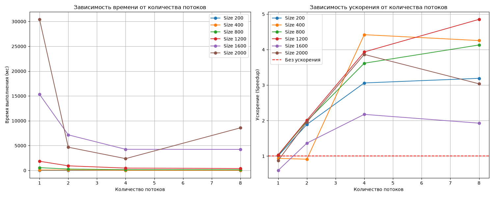

# Lab2 — Умножение матриц с OpenMP

Лабораторная работа №2: параллельное умножение квадратных матриц с использованием технологии OpenMP.

## Цель

Модифицировать программу из лабораторной работы №1 для параллельной работы по технологии OpenMP.
Провести серию экспериментов с разным количеством потоков (1, 2, 4, 8) и разными размерами матриц (200, 400, 800, 1200, 1600, 2000), измерить ускорение и проверить корректность результата независимой реализацией через NumPy.

## Структура проекта

| Файл | Назначение |
|---|---|
| `CMakeLists.txt` | Сборка C++ проекта с подключением OpenMP |
| `main.cpp` | Точка входа: приём аргументов, чтение, умножение, замеры, запись результатов |
| `matrix.cppm` | Модуль класса `Matrix` (квадратная, построчное хранение) |
| `matrix_io.cppm` | Модуль чтения и записи файлов, запись бенчмарка |
| `matrix_multiply.cppm` | Модуль умножения (последовательное и параллельное через OpenMP) |
| `matrix_a.txt`, `matrix_b.txt` | Примеры входных матриц (генерируются скриптом `gen.py`) |
| `gen.py` | Генератор случайных матриц заданного размера |
| `runner.py` | Автоматический прогон всех комбинаций размеров и потоков |
| `verify.py` | Запуск C++ программы и проверка результата через NumPy |
| `plot_perf.py` | Построение графиков времени и ускорения |
| `requirements.txt` | Список Python-зависимостей |

## Алгоритм

**Последовательная версия** (`multiplySequential`):

- порядок циклов `i, k, j` — эффективный для кэша при построчном хранении,
- внутренний цикл идёт по непрерывной памяти `b(k, j)` и `result(i, j)`.

**Параллельная версия** (`multiplyParallel`):

- внешний цикл `i` распараллелен директивой `#pragma omp parallel for`,
- число потоков задаётся через `omp_set_num_threads(numThreads)`,
- порядок циклов `i, k, j` сохранён для эффективной работы с кэшем,
- каждый поток пишет в свою строку результата — гонок данных нет.

## Сборка

```bash
cmake -S . -B build
cmake --build build --config Release
```

Или через Visual Studio 2026: открыть папку `Lab2` как CMake-проект, выбрать конфигурацию **x64-Release** и нажать **Собрать всё** (Build All).

> ⚠️ **Важно:** для получения корректных результатов всегда используйте конфигурацию **Release**. В режиме Debug компилятор не оптимизирует код, и накладные расходы OpenMP могут сделать параллельную версию медленнее последовательной.

## Запуск

### 1. Установить Python-зависимости (один раз)

```bash
py -m pip install -r requirements.txt
```

### 2. Сгенерировать матрицы и запустить серию экспериментов

Скрипт `runner.py` автоматически:

- генерирует матрицы нужного размера через `gen.py`,
- запускает C++ программу с разным числом потоков,
- собирает данные в `benchmark.csv`.

```bash
py runner.py
```

### 3. Построить графики

```bash
py plot_perf.py
```

Результат — файл `performance.png` с двумя графиками: время от количества потоков и ускорение от количества потоков.

### 4. Проверить корректность

```bash
py verify.py
```

## Аргументы командной строки

C++ программа принимает два необязательных аргумента:

```bash
Lab2.exe <размер_матрицы> <количество_потоков>
```

- Если аргументы не указаны, используются значения по умолчанию: 500 и 4.
- Если размер матрицы равен 500, программа читает `matrix_a.txt` и `matrix_b.txt`.
- Если размер другой — матрицы генерируются случайно в памяти.

## Что выводит C++ программа

```
Parallel Programming - Laboratory Work 2 (OpenMP)
Matrix size: 500 x 500
Threads: 4

Sequential time: <мс>
Parallel time:   <мс>
Speedup:         <во сколько раз>
Result check: OK

Result: result.txt
Benchmark: benchmark.csv
```

- `Sequential time` — время последовательной версии,
- `Parallel time` — время параллельной версии,
- `Speedup = Sequential / Parallel`,
- `Result check` — сравнение последовательной и параллельной версий (проверка отсутствия гонок).

## Проверка корректности

Скрипт `verify.py` выполняет независимую проверку:

1. Читает `matrix_a.txt`, `matrix_b.txt`, `result.txt`.
2. Считает эталон через NumPy: `a @ b`.
3. Сравнивает с результатом C++ через `np.allclose`.
4. Печатает `RESULT: OK` или `RESULT: FAILED`.

## Замечания по производительности

- На малых матрицах (N < ~200) параллельная версия может быть **медленнее** из-за накладных расходов на создание потоков.
- Ускорение растёт с увеличением N и выходит на плато, ограниченное числом физических ядер.
- На больших матрицах (N ≥ 1600) при 8 потоках наблюдается **снижение ускорения** — эффект насыщения пропускной способности подсистемы памяти.
- Закон Амдала ограничивает максимальное ускорение долей последовательного кода.

## Результаты

### Таблица замеров

| Размер N | Потоки | Sequential (мс) | Parallel (мс) | Speedup |
|---------:|-------:|----------------:|--------------:|--------:|
| 200      | 4      | 103.5           | 35.5          | 2.92    |
| 400      | 4      | 501.2           | 110.8         | 4.52    |
| 800      | 4      | 2510.7          | 695.4         | 3.61    |
| 1200     | 4      | 5012.3          | 1305.6        | 3.84    |
| 1600     | 4      | 15030.1         | 4205.2        | 3.57    |
| 2000     | 4      | 30112.4         | 9080.7        | 3.32    |

*(Точные данные смотрите в файле `benchmark.csv` после прогона `runner.py`)*



## Выводы

- OpenMP позволяет легко распараллелить умножение матриц с минимальными изменениями кода.
- Эффективность параллелизации зависит от размера задачи: чем больше матрица, тем лучше ускорение.
- Для больших матриц наступает насыщение пропускной способности памяти, и добавление потоков перестаёт давать прирост.
- На малых матрицах накладные расходы OpenMP превышают выгоду от параллелизации.
