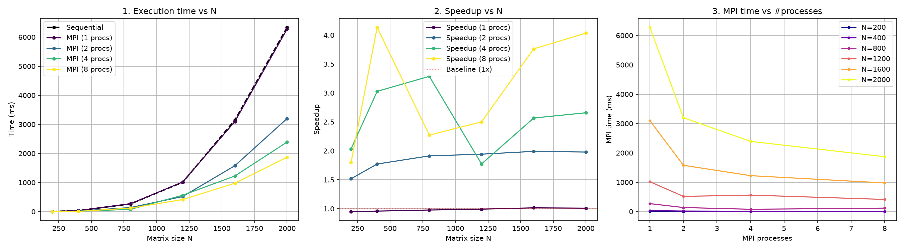

# Lab3 — Умножение матриц с MPI

Лабораторная работа №3: параллельное умножение квадратных матриц с использованием технологии MPI. Программа запускается на суперкомпьютере «Сергей Королёв» Самарского университета.

## Цель

Модифицировать программу из лабораторной работы №1 для параллельной работы по технологии MPI.
Провести серию экспериментов с разными размерами матриц (200, 400, 800, 1200, 1600, 2000) и разным количеством вычислительных ядер (1, 2, 4, 8), измерить ускорение и проверить корректность результата.

## Структура проекта

| Файл | Назначение |
|---|---|
| CMakeLists.txt | Сборка C++ проекта с подключением MPI |
| main.cpp | Точка входа: чтение, последовательное и MPI-умножение, замеры, проверка корректности |
| matrix.hpp | Класс Matrix (квадратная, построчное хранение) |
| matrix_io.cpp / .hpp | Чтение и запись матриц, запись бенчмарка в benchmark.csv |
| matrix_multiply.cpp / .hpp | Умножение: последовательное (multiplySequential) и параллельное (multiplyMPI) |
| mpi_utils.cpp / .hpp | Обёртка над MPI для инициализации и финализации окружения |
| gen.py | Генератор случайных матриц заданного размера (NumPy) |
| generate_matrices.sh | Генерация матриц всех нужных размеров прямо на кластере |
| run_all.slurm | Скрипт для автоматического запуска серии экспериментов через Slurm |
| run_lab3.slurm | Скрипт для одиночного запуска программы |
| plot_perf.py | Построение графиков времени и ускорения |
| benchmark.csv | Собранные результаты всех экспериментов |

## Алгоритм

**Последовательная версия** (multiplySequential):

- порядок циклов i, k, j — эффективный для кэша при построчном хранении,
- внутренний цикл идёт по непрерывной памяти b(k, j) и result(i, j).

**Параллельная версия** (multiplyMPI):

- матрица B целиком рассылается всем процессам через MPI_Bcast,
- строки матрицы A распределяются между процессами через MPI_Scatterv,
- каждый процесс считает свой блок результирующих строк,
- результаты собираются на нулевом процессе через MPI_Gatherv,
- нулевой процесс также участвует в вычислениях (не простаивает).

## Сборка

Локально (Windows, MS-MPI):

    ```
    cmake -S . -B build
    cmake --build build --config Release
    ```

На суперкомпьютере (Intel MPI):
    ```
    module load intel/icc18
    module load intel/mpi4
    mpiicpc -std=c++11 -O2 -o Lab3 main.cpp matrix_io.cpp matrix_multiply.cpp mpi_utils.cpp
    ```

> ⚠️ **Важно:** для получения корректных результатов всегда используйте оптимизацию (-O2 или конфигурацию **Release**). В режиме Debug накладные расходы MPI могут сделать параллельную версию медленнее последовательной.

## Запуск

### 1. Установить Python-зависимости (локально, один раз)

    ```
    py -m pip install pandas matplotlib numpy
    ```

### 2. Сгенерировать матрицы и запустить серию экспериментов на кластере

Скрипт generate_matrices.sh генерирует папки matrices_200, matrices_400, …, matrices_2000 с файлами matrix_a.txt и matrix_b.txt.

    ```
    chmod +x generate_matrices.sh
    ./generate_matrices.sh
    ```

Скрипт run_all.slurm автоматически перебирает все комбинации (6 размеров × 4 варианта ядер = 24 запуска) и дописывает результаты в benchmark.csv.
    
    ```
    sbatch run_all.slurm
    ```

Мониторинг задания:

    ```
    squeue -u $USER
    ```

### 3. Скачать результаты и построить графики (локально)

Скачайте benchmark.csv через WinSCP и запустите:

    ```
    py plot_perf.py
    ```

Результат — файл performance.png с тремя графиками: время от размера, ускорение от размера и время MPI от количества процессов.

## Аргументы командной строки

C++ программа запускается без аргументов и читает файлы matrix_a.txt и matrix_b.txt из текущей директории. Размер матрицы определяется автоматически из первой строки файла.

## Что выводит C++ программа

    ```
    Laboratory Work 3: Sequential + MPI
    Matrix size: 2000 x 2000
    MPI processes: 8

    Sequential:   <мс>
    MPI (8 procs): <мс>  (speedup <во сколько раз>)

    MPI vs Sequential: OK
    ```

- Sequential — время последовательной версии,
- MPI — время параллельной версии,
- speedup = Sequential / MPI,
- MPI vs Sequential — сравнение результатов последовательной и MPI-версий (проверка корректности).

## Проверка корректности

Корректность проверяется прямо в main.cpp: после обоих умножений матрицы seqRes и mpiRes поэлементно сравниваются. При совпадении выводится MPI vs Sequential: OK.

## Замечания по производительности

- На малых матрицах (N = 200) ускорение близко к 1: накладные расходы MPI (Bcast, Scatterv, Gatherv) превышают выгоду от параллелизма.
- Ускорение растёт с увеличением N. На матрице 2000×2000 при 8 процессах достигается ускорение ≈ 4×.
- Идеальное линейное ускорение недостижимо из-за передачи данных и доли последовательного кода (закон Амдала).
- Наблюдается немонотонность ускорения на отдельных размерах (например, N = 1200), связанная с распределением блоков и кэш-эффектами.

## Результаты

### Таблица замеров

| Размер N | Процессы | Sequential (мс) | MPI (мс) | Speedup |
|---------:|---------:|----------------:|---------:|--------:|
| 200      | 1        | 4.348                | 4.571                | 0.951  |
| 200      | 2        | 4.230                | 2.787                | 1.517  |
| 200      | 4        | 4.309                | 2.119                | 2.033  |
| 200      | 8        | 4.309                | 2.395                | 1.798  |
| 400      | 1        | 33.085               | 34.517               | 0.958  |
| 400      | 2        | 33.077               | 18.664               | 1.772  |
| 400      | 4        | 33.536               | 11.075               | 3.027  |
| 400      | 8        | 33.636               | 8.137                | 4.133  |
| 800      | 1        | 265.303              | 271.450              | 0.977  |
| 800      | 2        | 265.829              | 138.973              | 1.912  |
| 800      | 4        | 260.746              | 79.315               | 3.287  |
| 800      | 8        | 270.362              | 118.999              | 2.271  |
| 1200     | 1        | 1010.347             | 1018.339             | 0.992  |
| 1200     | 2        | 1007.220             | 518.544              | 1.942  |
| 1200     | 4        | 997.627              | 562.548              | 1.773  |
| 1200     | 8        | 1036.539             | 414.542              | 2.500  |
| 1600     | 1        | 3146.684             | 3098.318             | 1.015  |
| 1600     | 2        | 3142.634             | 1578.498             | 1.990  |
| 1600     | 4        | 3143.949             | 1224.806             | 2.566  |
| 1600     | 8        | 3673.475             | 976.423              | 3.762  |
| 2000     | 1        | 6335.341             | 6276.554             | 1.009  |
| 2000     | 2        | 6332.853             | 3199.646             | 1.979  |
| 2000     | 4        | 6359.576             | 2392.550             | 2.658  |
| 2000     | 8        | 7549.729             | 1871.301             | 4.034  |

(Полные данные по всем размерам смотрите в файле benchmark.csv)



## Выводы

- MPI позволяет распараллелить умножение матриц между процессами, в том числе на разных узлах кластера.
- Эффективность параллелизации зависит от размера задачи: чем больше матрица, тем лучше ускорение.
- На малых матрицах накладные расходы на пересылку данных превышают выгоду от параллелизации.
- На матрице 2000×2000 при 8 процессах достигнуто ускорение ≈ 4×, что подтверждает эффективность MPI для ресурсоёмких вычислений.
