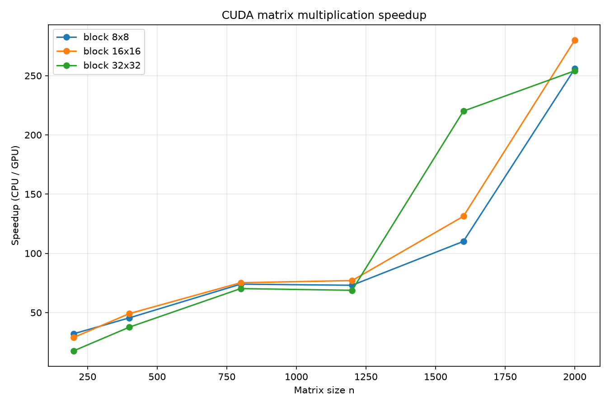

# Lab4 — Умножение матриц с CUDA

Лабораторная работа №4: параллельное умножение квадратных матриц с использованием технологии NVIDIA CUDA.
Модификация программы из лабораторной работы №1 для параллельной работы на GPU.

## Цель

Модифицировать программу из лабораторной работы №1 для параллельной работы по технологии CUDA.
Провести серию экспериментов с разными размерами матриц (200, 400, 800, 1200, 1600, 2000) и различными конфигурациями сетки блоков (8x8, 16x16, 32x32), измерить ускорение и проверить корректность результата независимой реализацией через NumPy.

## Структура проекта

| Файл | Назначение |
|---|---|
| `CMakeLists.txt` | Сборка C++/CUDA проекта |
| `main.cu` | Точка входа: приём аргументов, чтение, умножение (CPU и GPU), замеры, запись результатов |
| `matrix.h` | Заголовочный файл класса `Matrix` (квадратная, построчное хранение) |
| `matrix_io.cpp/h` | Чтение и запись файлов, запись бенчмарка |
| `matrix_cpu.cpp/h` | Последовательное умножение матриц на CPU |
| `matrix_cuda.cu/cuh` | Параллельное умножение матриц на GPU с использованием тайлинга |
| `matrix_a_<N>.txt`, `matrix_b_<N>.txt` | Входные матрицы (генерируются скриптом `gen.py`) |
| `gen.py` | Генератор случайных матриц заданного размера |
| `runner.py` | Автоматический прогон всех комбинаций размеров и блоков |
| `verify.py` | Независимая проверка результата через NumPy |
| `benchmark.csv` | Таблица с результатами замеров |
| `speedup.png` | График зависимости ускорения от размера матрицы |
| `CMakeSettings.json` | Настройки CMake для Visual Studio |

## Алгоритм

**Последовательная версия (CPU, `multiplySequential`):**
- Наивный тройной цикл `i, j, k` (или `i, k, j` для лучшей локальности кэша).
- Служит эталоном для проверки корректности и базой для расчёта ускорения.

**Параллельная версия (GPU, `multiplyCuda`):**
- Используется **тайлинг (tiled)** алгоритм с разделяемой памятью (`__shared__`).
- Каждый блок потоков вычисляет подматрицу (тайл) размером `TILE x TILE`.
- Внутри блока потоки кооперативно загружают тайлы матриц A и B в разделяемую память, что значительно снижает количество обращений к глобальной памяти.
- Реализованы шаблонные ядра для размеров блока 8x8, 16x16 и 32x32.
- Синхронизация потоков внутри блока осуществляется через `__syncthreads()`.

## Сборка

```bash
cmake -S . -B build
cmake --build build --config Release
```

Или через Visual Studio: открыть папку `Lab4` как CMake-проект, выбрать конфигурацию **x64-Release** и нажать **Собрать всё** (Build All).

> ⚠️ **Важно:** для получения корректных результатов всегда используйте конфигурацию **Release**. В режиме Debug компилятор не оптимизирует код, и накладные расходы CUDA могут сделать параллельную версию медленнее.

## Запуск

### 1. Установить Python-зависимости (один раз)

```bash
py -m pip install -r requirements.txt
```
### 2. Сгенерировать матрицы и запустить серию экспериментов

Скрипт `runner.py` автоматически:
- генерирует матрицы нужного размера через `gen.py`,
- запускает C++/CUDA программу с разными размерами блоков,
- собирает данные в `benchmark.csv`,
- строит график `speedup.png`.

```bush
py runner.py
```

### 3. Проверить корректность

```bush
py verify.py <размер_матрицы>
```

## Аргументы командной строки

C++ программа принимает три аргумента:

```bash
Lab4.exe <matrix_a> <matrix_b> <block_size>
```

- `<matrix_a>`, `<matrix_b>` — имена файлов с входными матрицами (например, `matrix_a_200.txt`).
- `<block_size>` — размер блока CUDA (8, 16 или 32).

## Что выводит C++ программа
```
Matrix size:  200
Block size:   16 x 16
CPU time:     2.9241 ms
GPU time:     0.0911 ms
Result check: OK (maxDiff = 0)
Speedup:      32.085

Result:    result.txt
Benchmark: benchmark.csv
```
- `CPU time` — время последовательной версии,
- `GPU time` — время выполнения ядра CUDA (без учёта копирования данных),
- `Speedup = CPU / GPU`,
- `Result check` — сравнение результатов CPU и GPU (проверка отсутствия ошибок).

## Проверка корректности

Скрипт `verify.py` выполняет независимую проверку:
1. Читает `matrix_a_<N>.txt`, `matrix_b_<N>.txt` и `result.txt`.
2. Считает эталон через NumPy: `a @ b`.
3. Сравнивает с результатом C++ через `np.array_equal`.
4. Печатает `SUCCESS` или `FAILURE`.

## Замечания по производительности

- На малых матрицах (N=200) ускорение составляет ~30x, что связано с накладными расходами на копирование данных и запуск ядер.
- С ростом размера матрицы ускорение растёт и достигает **255–280x** на N=2000.
- Размер блока 16x16 часто показывает наилучший результат на больших матрицах, обеспечивая баланс между параллелизмом и использованием ресурсов.
- Блок 8x8 даёт меньшее ускорение из-за меньшего количества потоков, а 32x32 может страдать от недостатка Occupancy.
- Наблюдается аномалия на N=1600 с блоком 32x32 (высокое время CPU), что, вероятно, связано с шумом измерений или фоновыми процессами.

## Результаты

### Таблица замеров (фрагмент)

| Размер N | Блок | CPU (мс) | GPU (мс) | Speedup | Check |
|---------:|-----:|---------:|---------:|--------:|-------|
| 200      | 16   | 3.0831   | 0.1065   | 28.95   | OK    |
| 400      | 16   | 31.2767  | 0.6367   | 49.12   | OK    |
| 800      | 16   | 368.2880 | 4.8966   | 75.21   | OK    |
| 1200     | 16   | 1264.0100| 16.4157  | 77.00   | OK    |
| 1600     | 16   | 5102.9600| 38.8738  | 131.27  | OK    |
| 2000     | 16   | 20814.400| 74.3313  | 280.02  | OK    |

*(Полные данные смотрите в файле `benchmark.csv`)*



## Выводы

- CUDA позволяет достичь значительного ускорения умножения матриц (до 280x на больших размерах) по сравнению с наивной CPU-версией.
- Эффективность параллелизации сильно зависит от размера задачи: чем больше матрица, тем лучше ускорение.
- Использование разделяемой памяти (тайлинг) критически важно для производительности, так как снижает нагрузку на глобальную память.
- Выбор размера блока является компромиссом: слишком маленький блок не даёт достаточного параллелизма, слишком большой — ограничивает Occupancy.
- На малых матрицах накладные расходы CUDA (копирование, запуск ядер) превышают выгоду от параллелизации.
