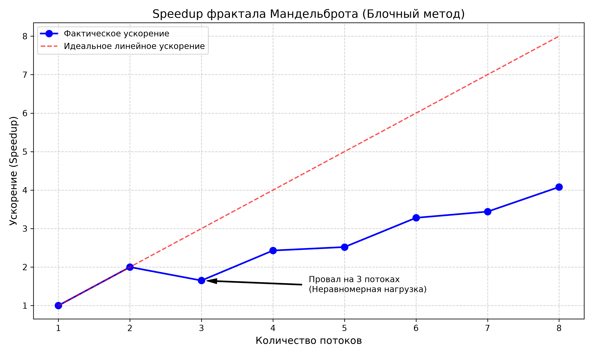
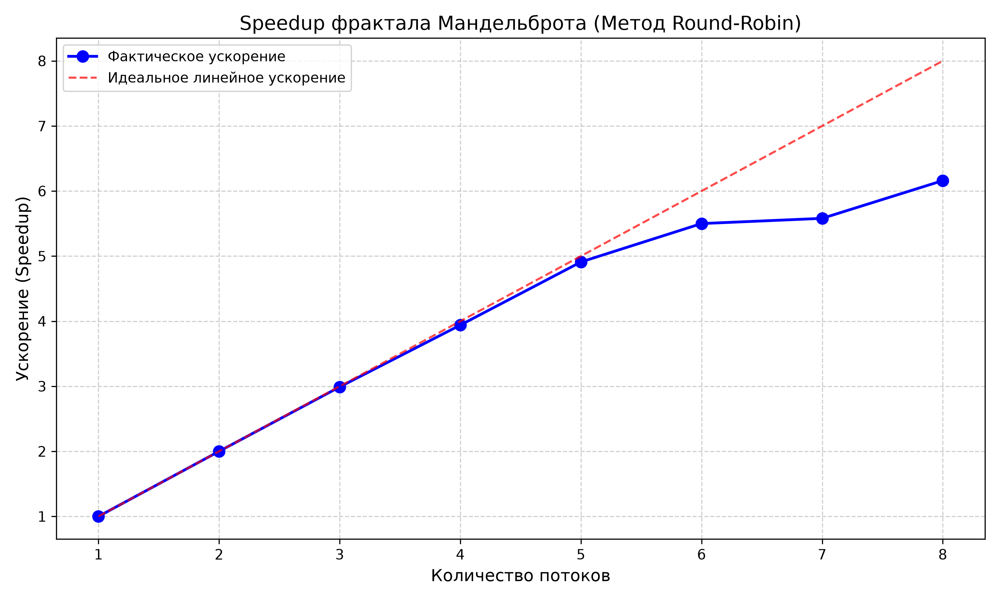

# Лабораторная работа: Параллельная генерация фрактала Мандельброта

# Выполнил
Атаманов Павел

## Описание проекта
В данной работе реализована и оптимизирована параллельная программа генерации изображения фрактала Мандельброта с использованием библиотеки `std::thread` на C++. Работа выполнялась в среде Visual Studio на ОС Windows. 

**Оборудование:** 
* Процессор: (Intel Core i7-13620H)
* Физических ядер: 10
* Логических потоков (Hyper-Threading): 16

## Выполнение задания

### 1. Базовая параллелизация (Блочный метод)
Изначально изображение было разделено на горизонтальные блоки: поток 0 считал верхнюю половину, поток 1 — нижнюю. При увеличении количества потоков каждый получал сплошной блок строк.

### 2. Анализ производительности (Блочный метод)
Были проведены замеры времени для 1-8 потоков. Построен график зависимости ускорения (Speedup) от количества потоков.

**Анализ графика:**
* Ускорение не является линейным.
* Наблюдается **провал на 3 потоках** (ускорение падает с 2x до 1.64x).
* **Гипотеза:** Это вызвано неравномерной нагрузкой (Load Imbalance). Центральная часть фрактала вычисляется дольше, чем края. При делении на 3 блока среднему потоку досталась самая "тяжелая" часть.

### 3. Доказательство гипотезы (Замеры потоков)
Для подтверждения гипотезы в функцию `workerThreadStart` были добавлены таймеры (`CycleTimer`). 

*(Примечание: вставьте скриншот консоли с временами потоков)*

**Результат:**
При запуске с 3 потоками время выполнения составило:
* Thread 0: ~53 мс
* Thread 1: **~164 мс**
* Thread 2: ~53 мс

Это доказывает, что общее время выполнения (164 мс) определялось самым медленным потоком, пока остальные простаивали.

### 4. Оптимизация (Метод Round-Robin)
Для устранения неравномерной нагрузки был применен метод **чередования строк (Round-Robin)**. Каждый поток теперь обрабатывает строки с шагом, равным количеству потоков (например, поток 0 берет строки 0, 3, 6... для 3 потоков).

**Результат:**
* Провал на 3 потоках исчез (ускорение достигло **2.89x**, что близко к идеалу 3.0x).
* Ускорение на 8 потоках выросло до **~6.2x** (по сравнению с 4.1x в блочном методе).

### 5. Анализ 16 потоков
При запуске оптимизированного кода с 16 потоками было получено ускорение **7.65x**. 

**Вывод:** 
Хотя 16 потоков дали небольшой прирост, это не является линейным масштабированием. Процессор имеет только 4 физических ядра (и 8 логических благодаря Hyper-Threading). Запуск 16 потоков приводит к накладным расходам на переключение контекста (Context Switching), так как физически одновременно могут работать только 8 потоков. Увеличение количества потоков сверх количества логических ядер нецелесообразно.

## Как запустить
1. Склонируйте репозиторий.
2. Откройте папку `prog1_mandelbrot_threads` в Visual Studio.
3. Соберите проект в конфигурации **Release**.
4. Запустите программу с нужным количеством потоков: `.\mandelbrot.exe -t 8`

## Ссылки
* [Оригинальное задание CS149](https://github.com/stanford-cs149/asst1)
